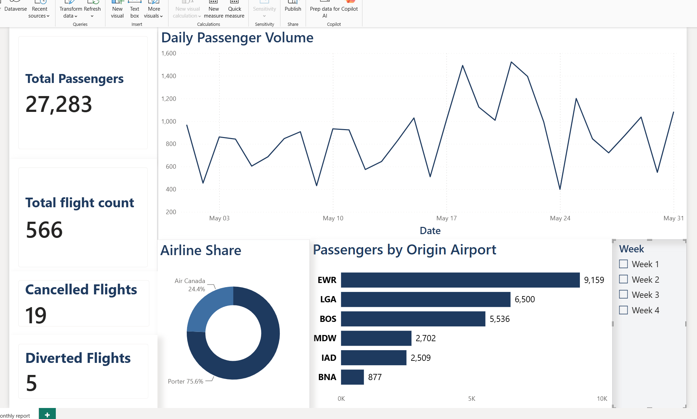
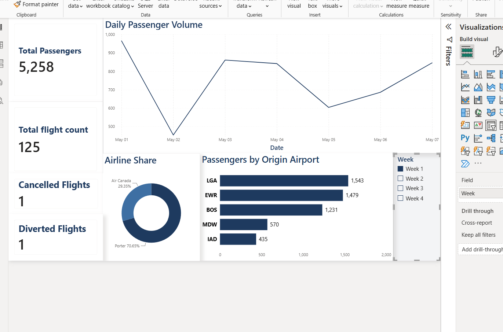
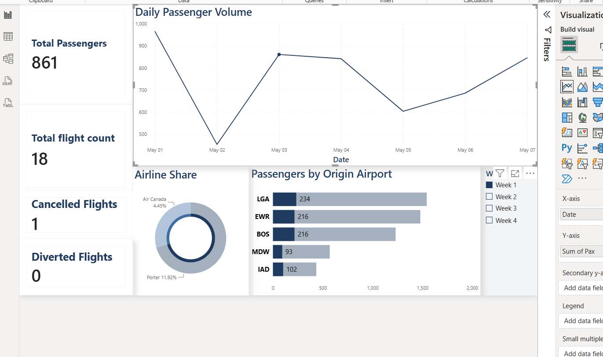
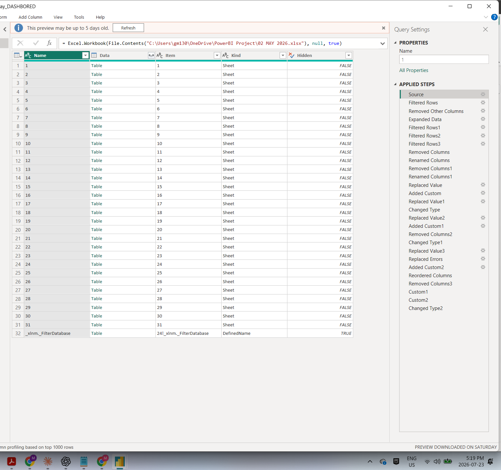

# Flight Operations ETL Pipeline and Power BI Dashboard

## Overview

This project demonstrates an end-to-end data cleaning and reporting workflow built on realistic, imperfect source data. The source was a single Excel workbook containing 31 worksheets, one handwritten shift report for each day of May. The data exhibited inconsistent headers, summary rows embedded within records, numeric values stored as text, misspelled flight numbers, and implausible negative values, which is representative of manually maintained operational reporting.

The objective was to consolidate these reports into a single, validated dataset and present it in an interactive dashboard. The result is 566 verified flight records, produced by a transformation process designed to run unchanged on a subsequent month's workbook.

> **Data disclosure:** This repository contains only information suitable for public sharing: flight numbers, times, gates, passenger counts, and origin airports. No confidential data is included.

---

## Dashboard Preview

**Full-month view: 27,283 passengers across 566 flights**



**Week 1 view, filtered using the week slicer**



**Visual and field configuration**



**Power Query Editor: applied transformation steps**



---

## Summary of Results

| Metric | Value |
|---|---|
| Total flights | 566 |
| Arrived | 542 |
| Cancelled | 19 |
| Diverted | 5 |
| Total passengers | 27,283 |
| Origin airports | EWR, LGA, BOS, MDW, IAD, BNA |
| Carriers | Porter (approximately 75% of passengers), Air Canada (remainder) |

---

## Data Preparation

The majority of the project effort was spent on data preparation. The principal challenges and their resolutions are described below.

- **Consolidation of 31 worksheets.** The daily sheets had inconsistent structures. Header, blank, and total rows were removed from all sheets programmatically, and the results were appended into a single table. The query is parameter-free, so a new month's workbook passes through the same steps without modification.
- **Data type correction.** Columns stored as text were converted to the appropriate numeric and time types.
- **Validation of passenger counts.** A rule was added to identify and clear impossible values, such as negative passenger counts caused by data entry errors.
- **Flight number standardization.** Eighteen flight numbers were consistently misspelled across the source sheets. A single lookup-style transformation corrects all eighteen, rather than relying on manual edits.
- **Status derivation.** The source contained no dedicated status column; arrival, cancellation, and diversion information appeared in different columns depending on the day. Logic was written to scan for the relevant keywords and assign a consistent status to every flight.
- **Recalculation of processing time.** The original processing-time column mixed units and contained negative values, so it was excluded. Processing time was recalculated directly from the underlying timestamps.

The resulting dataset consists of 17 correctly typed, validated columns suitable for reporting.

---

## Airline Attribution

The source data identified flights only by number and did not record the operating carrier. The carrier was inferred from the flight number pattern using the following DAX measure:

```dax
Airline =
IF(
    LEFT(FORMAT('1'[Flight], "0"), 2) = "85" || FORMAT('1'[Flight], "0") = "9804",
    "Air Canada",
    "Porter"
)
```

---

## Dashboard Components

- **KPI cards** presenting headline figures
- **Line chart** showing daily passenger volume
- **Bar chart** showing flights by origin airport
- **Donut chart** showing the passenger split by carrier
- **Week slicer** allowing the user to view Weeks 1 through 4 or the full month

Custom colors, card styling, and a header banner were applied to improve readability and presentation.

---

## Tools and Technologies

- Power BI Desktop
- Power Query (M language)
- DAX
- Microsoft Excel (source data)
- OneDrive (file storage and synchronization across workstations)

---

## Repository Contents

```
flight-ops-etl-pipeline/
├── README.md
└── screenshots/
    ├── 01-dashboard-full-month.png
    ├── 02-dashboard-week1-filter.png
    ├── 03-visual-builder-slicer.png
    └── 04-power-query-applied-steps.png
```

The Power BI file (.pbix) and the source Excel workbook are not included in this repository, as they contain the complete dataset. This repository is intended to document the approach to the problem and the resulting deliverable.
